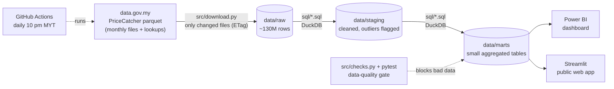

# 🍛 Nasi Lemak Index: Malaysia's grocery prices, decoded

[](https://github.com/Faryaan-Khan/nasi-lemak-index/actions/workflows/daily-update.yml)


[](LICENSE)
[](https://creativecommons.org/licenses/by/4.0/)


**How much does a plate of nasi lemak cost to make in Kota Bharu compared with Kuala Lumpur? Do
chicken and chilli prices jump before Hari Raya? Does the hypermarket really charge more than the
wet market down the road?**

This project answers those questions with the Malaysian government's own price data: **130 million
price records** since January 2022 from nearly 4,000 shops in every state, collected by KPDN field officers and published
by DOSM. Build a shopping basket and see where in Malaysia it's cheapest, which items spike before
festive seasons, and which store types charge more for the same item.

> **Status (Nov 2026):** the data pipeline is live and refreshes itself every night, and the
> 130M rows since 2022 are profiled, cleaned (Phase 2), aggregated into dashboard-ready tables
> (Phase 3), and turned into basket costs and festive price windows using official holiday dates
> (Phase 4). The analysis write-up (Phase 5) is next. Dashboard screenshots, headline insights and a live link
> will appear here as each phase lands. See the [roadmap](#roadmap).

---

## The questions

| # | Question | Business angle |
|---|---|---|
| 1 | **Where is my basket cheapest?** Basket cost by state and district, as a map and a ranking. | Regional pricing, cost-of-living gaps |
| 2 | **What spikes before Raya, CNY and Deepavali?** Which items rise, by how much, and how many weeks before. | Seasonal demand planning, promo timing |
| 3 | **Which store types charge a premium?** Hypermarket vs supermarket vs minimart vs wet market, same item, same district. | Channel pricing, competitive positioning |
| 4 | **What happens next?** A 4–8 week price forecast for key items (chicken, eggs, rice, onions, chilli). | Procurement and budgeting |

## What the data looks like so far

These come from the pipeline's own coverage table,
[`data/marts/coverage_monthly.csv`](data/marts/coverage_monthly.csv), which updates daily.
Price findings will be added once cleaning is done, because numbers from uncleaned data would be
misleading.

- **130,548,639 price records** from January 2022 to November 2026, about 170 MB of compressed
  parquet, queried on a laptop with DuckDB.
- **1.4 to 2.7 million prices a month**, covering ~340 items at ~2,100 shops.
- **The survey changed shape in mid-2025:** shops covered jumped from ~1,670 to ~2,400 in July
  2025 (settling at ~2,100 since), and the item list shrank from ~515 to ~345 in August 2025. Any trend analysis has to compare
  like with like across that break.
- **Collection gaps are real:** some months are missing days (October 2026 starts on the 10th),
  so every weekly figure carries an observation count.
- Data quirks found and documented before cleaning: placeholder `-1` shop and item codes,
  inconsistent category labels, ~1.9% of rows with item codes missing from the item lookup, and
  items dropped from the survey (ikan bilis hasn't been priced since July 2025).
  Full list in [`docs/schema.md`](docs/schema.md).

## How it works



**Design choices**

- **SQL first, on millions of rows.** All heavy lifting is plain SQL in [`sql/`](sql/), run by
  DuckDB directly on parquet files. No database server, no loading 130M rows into pandas.
- **Thin, trustworthy marts.** Power BI and Streamlit only read small pre-aggregated tables in
  `data/marts/`. Figures use **medians**, and each one carries the observation count behind it.
- **Outliers are flagged, not deleted.** Unit mix-ups and typos are marked per item and month so
  the decision is visible and reversible.

## Daily auto-refresh

A [GitHub Actions workflow](.github/workflows/daily-update.yml) runs every night at **10 pm
Malaysia time** on GitHub's servers:

1. Restores yesterday's raw files from the Actions cache.
2. Downloads **only files whose fingerprint (ETag) changed**, usually just the current month.
   A full re-check of all 59 months takes a few seconds.
3. Checks the raw data (expected columns, no missing or zero prices, data less than 14 days old).
4. Cleans all 130M rows and rebuilds the summary tables with DuckDB SQL.
5. Runs 38 tests on the cleaned data and summary tables. **If anything fails, nothing is published.**
6. Commits the small CSV tables and replaces the large ones on the
   [`data-latest` release](https://github.com/Faryaan-Khan/nasi-lemak-index/releases/tag/data-latest).

## Summary tables

Every figure is a **median** backed by **at least 3 shops**, with the price and shop counts on each row.

| Table | One row per | Rows | Get it |
|---|---|---|---|
| `dim_item` | item: name, unit, category | ~790 | [CSV](data/marts/dim_item.csv) |
| `dim_district` | district: state, region, shops by type | 169 | [CSV](data/marts/dim_district.csv) |
| `item_national_week` | item × week, all Malaysia, since 2022 | ~100k | [CSV](data/marts/item_national_week.csv) |
| `item_state_week` | item × state × week, last 2 years | ~414k | [parquet](https://github.com/Faryaan-Khan/nasi-lemak-index/releases/download/data-latest/item_state_week.parquet) |
| `item_district_week` | item × district × week, last 2 years | ~2.2M | [parquet](https://github.com/Faryaan-Khan/nasi-lemak-index/releases/download/data-latest/item_district_week.parquet) |
| `item_premisetype_district_month` | item × store type × district × month, last 2 years | ~825k | [parquet](https://github.com/Faryaan-Khan/nasi-lemak-index/releases/download/data-latest/item_premisetype_district_month.parquet) |
| `basket_cost_national_week` | basket × week, since 2022 | ~700 | [CSV](data/marts/basket_cost_national_week.csv) |
| `basket_cost_state_week` | basket × state × week | ~3.3k | [CSV](data/marts/basket_cost_state_week.csv) |
| `basket_cost_district_week` | basket × district × week | ~10.6k | [parquet](https://github.com/Faryaan-Khan/nasi-lemak-index/releases/download/data-latest/basket_cost_district_week.parquet) |
| `festive_window` | festival × item × week (−12 to +2), price index vs own baseline | ~76k | [CSV](data/marts/festive_window.csv) |

Baskets (Nasi Lemak, Student weekly, Family weekly) are defined in
[`data/reference/baskets.csv`](data/reference/baskets.csv) with real item codes; quantities are
illustrative. Festival dates for 2022–2027 are in
[`data/reference/festive_calendar.csv`](data/reference/festive_calendar.csv), each with its official source.

The large tables live on a release that is overwritten nightly, so the git history doesn't grow
by megabytes every day.

The badge at the top shows whether last night's run passed.

## Tech stack

| Layer | Tool | Why |
|---|---|---|
| Ingestion | Python, `requests` | Resumable downloads with ETag change detection |
| Storage | Parquet | Compressed, columnar: a month of ~1.5M prices is ~2 MB |
| Transformation | **DuckDB SQL** | Fast analytical SQL on parquet, runs inside Python |
| Analysis | pandas (small tables only), statsmodels | Aggregated outputs, ETS forecast vs seasonal-naive baseline |
| Quality | pytest, `src/checks.py` | Automated checks gate every refresh |
| Automation | GitHub Actions | Free nightly refresh, no server to run |
| Dashboard | **Power BI Desktop** | Data model, DAX measures, basket builder |
| Web app | Streamlit Community Cloud | Free public link to the core views |

## How to run it

Requires Python 3.11+. Commands are for Windows PowerShell.

```powershell
git clone https://github.com/Faryaan-Khan/nasi-lemak-index.git
cd nasi-lemak-index
python -m venv .venv
.\.venv\Scripts\python.exe -m pip install -r requirements.txt

.\.venv\Scripts\python.exe src\check_remote.py   # smoke test: DuckDB reads PriceCatcher over HTTPS
.\.venv\Scripts\python.exe src\download.py --all # everything since 2022 into data/raw (default: last 24 months)
.\.venv\Scripts\python.exe src\checks.py         # data-quality checks
.\.venv\Scripts\python.exe src\build.py          # run sql/ files: clean 130M rows and build tables (~7 min)
.\.venv\Scripts\python.exe -m pytest             # tests
```

On macOS or Linux, use `.venv/bin/python` and forward slashes instead.

## Roadmap

| Phase | What | Status |
|---|---|---|
| 0 | Setup, folder structure, remote parquet smoke test | ✅ Done |
| 1 | Resumable downloader, data-quality checks, daily GitHub Actions refresh | ✅ Done |
| 2 | Profile the data and clean it in SQL (placeholders, outliers, name standardisation) | ✅ Done |
| 3 | Marts: weekly item × district/state/national medians, store-type × district monthly medians | ✅ Done |
| 4 | Basket definitions (Nasi Lemak, Student, Family) and an official festive calendar | ✅ Done |
| 5 | Analysis: cheapest regions, festive spikes, store-type premium, East vs West Malaysia | ⏳ Planned |
| 6 | Forecast for 3–5 key items, ETS vs seasonal-naive baseline, holdout MAPE reported honestly | ⏳ Planned |
| 7 | Power BI dashboard: Overview, Basket Builder, Festive Spikes, Store-Type Premium, Forecast | ⏳ Planned |
| 8 | Streamlit web version with a free public link | ⏳ Planned |
| 9 | Polish: screenshots, headline insights, write-up | ⏳ Planned |

## Project layout

```
.github/workflows/   daily refresh (GitHub Actions)
data/raw, staging/   downloaded and cleaned parquet (git-ignored, too big for git)
data/marts/          small aggregated tables for Power BI / Streamlit
data/reference/      festive calendar, basket definitions
sql/                 numbered DuckDB SQL files, run in order
src/                 download, checks, build, forecast
notebooks/           exploration and profiling
dashboard/           Power BI file and screenshots
app/                 Streamlit app
docs/                notes.md (how and why, per phase), schema.md (data quirks), insights.md
tests/               pytest tests
```

## Important caveat

PriceCatcher is built for **price surveillance of specific items in specific places**, not for
measuring inflation. The Consumer Price Index (CPI) is Malaysia's official inflation measure.
"Nasi Lemak Index" is a playful basket name, not an inflation index.

## Limitations

- Coverage changes over time (items and shops are added and dropped), so long-run trends are only
  reported for items present throughout.
- Some days and weeks are thin or missing; figures show the observation count behind them.
- Restaurants and food courts appear as shop types but have no prices since 2022, so
  the analysis covers grocery retail only (supermarkets, hypermarkets, minimarts, wet markets,
  sundry shops).
- 0.71% of prices are flagged as outliers (typos, unit mix-ups) and left out of the figures; 1.9%
  have item codes the government lookup doesn't name, so they're excluded from item-level results.

More detail in [`docs/schema.md`](docs/schema.md) and [`docs/notes.md`](docs/notes.md).

## Data source and licence

Data: **PriceCatcher**, Ministry of Domestic Trade and Cost of Living (KPDN) and the Department of
Statistics Malaysia (DOSM), via [OpenDOSM](https://open.dosm.gov.my/data-catalogue/pricecatcher)
and [data.gov.my](https://data.gov.my), licensed under
[CC BY 4.0](https://creativecommons.org/licenses/by/4.0/).

Code: [MIT licence](LICENSE).

## About

Built by **Faryaan Khan**, final-year Computer Science (data science) student, as a portfolio project
for data analyst and BI roles. Built with AI-assisted development; every design choice is
explained in [`docs/notes.md`](docs/notes.md).
